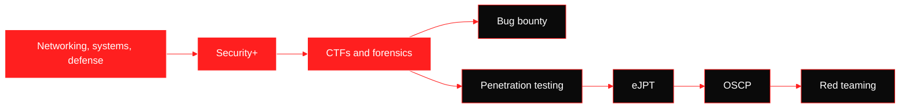

<p align="center">
  
</p>

<p align="center">
  <code>0xkarma13</code> · penetration tester in training · CTF player · Security+ certified
</p>

```console
karma@0x13:~$ cat about.txt

I play CTFs because they sharpen how I think, but they are practice, not the goal.
What I actually want is to find real problems in real systems, and help fix them.
I have a solid foundation, I'm learning constantly, and I love this work.
```

```diff
- CTF is the gym.
+ the real world is the match.
```

---

## `$ cat philosophy.txt`

```console
Someone who knows how a system works, and how it gets defended,
can attack it more easily and hack it better.

Networking, systems, defense, offense: it's all connected.
And if there's something to learn, I go all the way to the bottom of it.
```

---

## `$ cat status.log`

```console
[done]     bootcamp: digital forensics
[running]  Unlim bootcamp (3 months)
[running]  articles: Java Deserialization vulnerabilities
[running]  CTFs (picoCTF, TryHackMe) with a write-up for each
[running]  bug bounty on HackerOne
[running]  coding practice: Python, C
[next]     eJPT
[later]    OSCP, red teaming
[aiming]   WorldSkills, national olympiad
```

---

## `$ cat roadmap.mmd`



Red means done or in progress.

---

## `$ ls ~/scripts`

```console
I write my own scripts and small tools to understand how things really work,
including a keylogger I built in my own lab, purely for learning.

I code regularly to keep improving: Python and C now, maybe more languages later.
```

Tools I use change with every challenge, so I don't list them all here. You'll find the ones I used in each write-up, inside the repos below.

---

## `$ cat case_files.log`  (a few cases I'm proud of)

| Case | Platform | Category | What it took |
|------|----------|----------|--------------|
| Dreaming | TryHackMe | Web | DNS recon, fuzzing, Pluck CMS CVE-2020-29607 `.phar` upload to RCE |
| Broken Access Control | TryHackMe | Web | IDOR and privilege escalation by flipping an `isadmin` param in Burp |
| Carnage | TryHackMe | DFIR | Malspam pcap in Wireshark: Squirrelwaffle, Qakbot, Cobalt Strike |
| midnight_beacon | unlim.ir | Forensics | DNS beacon chunks in a pcap, base64, XOR |
| W1seGuy | TryHackMe | Crypto | XOR known-plaintext attack |
| MemLabs Lab 0 | MemLabs | Memory forensics | Volatility `windows.info` and first steps |

These are just a few. **The rest of my write-ups are in the repos**, no flags spoiled:
[pentest-writeups](https://github.com/0xkarma13/pentest-writeups) · [ctf-writeups](https://github.com/0xkarma13/ctf-writeups)

---

## `$ ls work/`

```console
pentest-writeups/                lab reports, TryHackMe write-ups
ctf-writeups/                    forensics, crypto, web challenges
cybersecurity-notes/             linux, networking, crypto notes
cybersecurity-knowledge-base/    research and resources
```

[pentest-writeups](https://github.com/0xkarma13/pentest-writeups) ·
[ctf-writeups](https://github.com/0xkarma13/ctf-writeups) ·
[cybersecurity-notes](https://github.com/0xkarma13/cybersecurity-notes) ·
[cybersecurity-knowledge-base](https://github.com/0xkarma13/cybersecurity-knowledge-base)

---

## `$ cat rules.txt`

```console
1. Understand it before you exploit it.
2. If I can't explain it, I haven't solved it yet.
3. Every solve gets a write-up, written in my own words.
4. Never publish the flag, publish the thinking.
5. Break things only where I'm allowed to.
```

---

## `$ ./collaborate --open`

```console
Want to team up for CTFs, work on something together,
or need a hand with something I might know?
Message me anywhere below. I'm happy to help or collaborate.
```

---

## `$ cat contact`

```console
linkedin    in/createrkarma11
hackerone   <your-username>
tryhackme   <your-username>
email       CreaterKarma9900@gmail.com
```

[LinkedIn](https://linkedin.com/in/createrkarma11) · [Email](mailto:CreaterKarma9900@gmail.com)

```console
karma@0x13:~$ _
```
